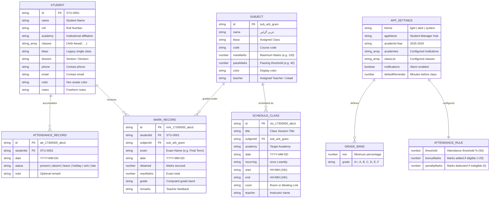

# STUDENT MANAGEMENT PROJECT AUDIT
**Project Name:** Nova Student Manager (Student Manager Hub)  
**Package Identifier:** `com.alphainteractive.studentmanager`  
**Application Version:** v1.1.03 (Build Code: 4)  
**Auditor:** Senior Software Architect, Full-Stack Developer & Technical Auditor  
**Target Audience:** Developer / Technical Team  
**Audit Date:** November 2026  
**Audit Scope:** Full Codebase & Architectural Inspection  

---

## 1. Executive Summary

This audit represents a comprehensive technical and functional evaluation of the **Nova Student Manager** project (also known internally as **Student Manager Hub**). The application is an offline-first student, attendance, academic marks, schedule, and grade management tool tailored specifically for independent educators and tutors managing students across online Islamic academies (specifically **AL Momina Online Islamic Academy** and **Dare Arqam Online Islamic Academy**).

### Key Architectural Discovery: The Three Distinct Implementations
Inspection of the repository reveals three distinct incarnations and development streams co-existing in the same workspace:

1. **The Active Production Core (`index.html` + Hybrid WebView wrapper):**  
   The full, live, feature-complete application is a **7,558-line monolithic single-page progressive web application (SPA)** in vanilla HTML5, CSS3, and JavaScript located at `index.html`. It is bundled directly into the mobile application (`StudentManagerApp`) as a Base64-encoded payload (`StudentManagerApp/src/htmlBundle.ts` via `bundle_html.py`) and executed inside a native `react-native-webview`. A bidirectional JavaScript bridge mirrors all application state into native Android `AsyncStorage` (`@smh_permanent_storage_v1`), ensuring zero data loss across WebView cache clears or APK upgrades. This architecture powers the release APKs found in the root directory (`NovaStudentManager-v1.1.01.apk` and `NovaStudentManager-v1.1.03.apk`).
2. **The Dormant Native React Native UI (`StudentManagerApp/src/screens/`):**  
   A complete set of native React Native screens (`AttendanceScreen.tsx`, `DashboardScreen.tsx`, `MarksScreen.tsx`, `PercentageScreen.tsx`, `ReportsScreen.tsx`, `ScheduleScreen.tsx`, `SettingsScreen.tsx`, `StudentsScreen.tsx`), navigation components (`Sidebar.tsx`, `Topbar.tsx`), state context (`AppContext.tsx`), and math utilities (`calculations.ts`) exists under `StudentManagerApp/src/`. While syntactically valid and passing strict TypeScript compilation (`npx tsc --noEmit` exits with 0 errors), **these native React Native components are currently dormant dead code**. The mobile entrypoint (`StudentManagerApp/App.tsx`) bypasses them entirely to render the WebView engine.
3. **The Unfinished Native Android Compose Application (`StudentManagerHub/`):**  
   A separate standalone native Android project built with Kotlin, Jetpack Compose (Material 3), and Android Room Database (`student_manager.db`). This implementation only completed Stage 1 and Stage 2 (Student Registry and Theme Preferences). All other modules (`AttendanceScreen.kt`, `MarksScreen.kt`, `ScheduleScreen.kt`, `PercentageCalculatorScreen.kt`, `ReportsScreen.kt`) are placeholder screens explicitly marked *"Coming in Stage 4/5/6/9/10"*.

### System Health & Maturity Overview
* **Active Feature Completeness:** **8.8 / 10** for the single-tutor offline use-case (Attendance matrix, marks register, automatic holiday rules, 2x Retina canvas image generator, backup/restore, CSV export, and percentage calculators are operational in `index.html`).
* **Multi-User / Enterprise Readiness:** **1.0 / 10** (No teacher authentication, no login/logout, no user roles, no multi-tenant isolation, no remote backend database, and no API security).
* **Architectural Cleanliness:** **4.5 / 10** (A 7,558-line monolithic HTML/JS bundle coupled with dormant React Native code and a stalled Kotlin Compose codebase represents high technical debt and divergent maintenance streams).

---

## 2. Project Overview

Nova Student Manager is designed for teachers and tutors who require an instantaneous, offline, zero-latency registry to manage student enrollments, record daily attendance, enter examination scores, compute overall percentages and grades, and generate sharable attendance sheets and reports.

### Primary Domain Specialization
* **Target Audience:** Independent private teachers / Islamic academy ustads.
* **Institutions Managed:** Pre-configured and customizable for:
  1. *AL Momina Online Islamic Academy* (Features custom Saturday + Sunday weekend holiday rules).
  2. *Dare Arqam Online Islamic Academy* (Features standard Sunday holiday rules).
* **Academic Subjects & Batches:** Pre-loaded with classical Arabic and Islamic studies curricula, including *Arbi Awwal*, *Arbi Duwwam*, *Arbi Chahrum*, *Arabic Grammar (Morning Batch)*, *Arabic Grammar (Evening Batch)*, *Tajweed*, and *Tarjuma*.
* **Bilingual Arabic/Urdu Typography:** Configured with Google Fonts (`Amiri`, `Noto Naskh Arabic`, `Plus Jakarta Sans`) and CSS RTL text-rendering support.
* **Exam Eligibility & Attendance Rules:** Dynamic evaluation logic granting automatic bonus marks (e.g., +20 marks) if attendance meets a set threshold (e.g., 50%) or disqualifying students from examination eligibility if below threshold.

---

## 3. Technology Stack

The workspace utilizes different technology stacks across its three modules:

```
+---------------------------------------------------------------------------------------+
|                                NOVA STUDENT MANAGER                                   |
+---------------------------------------------------------------------------------------+
|  Active Runtime (Hybrid Mobile / Web)  |  Dormant Native Code  |  Incomplete Native   |
+----------------------------------------+-----------------------+----------------------+
|  - HTML5 / CSS3 / Vanilla JS (ES6)     |  - React Native 0.86  |  - Kotlin 2.0+       |
|  - Google Fonts (Amiri, Naskh Arabic)  |  - React 19.2.3       |  - Jetpack Compose   |
|  - Expo SDK 57 (react-native-webview)  |  - TypeScript 6.0     |  - Android Room DB   |
|  - Custom Kotlin Native FileSaver      |  - AsyncStorage       |  - Gradle Kotlin DSL |
|  - LocalStorage + AsyncStorage Bridge  |  - React Context API  |  - DataStore Prefs   |
+---------------------------------------------------------------------------------------+
```

### Detailed Component Stack Breakdown

| Technology / Library | Version / Target | Where Used | Function / Purpose |
| :--- | :--- | :--- | :--- |
| **HTML5 & CSS3** | Modern Living Standard | `index.html` | Semantic markup, responsive layout, CSS variables, dark/light theme styling, CSS Grid/Flexbox. |
| **Vanilla JavaScript** | Modern ES5/ES6 Strict | `index.html` | Core UI rendering engine, state management, modal system, matrix grid logic, math calculations, search. |
| **HTML5 Canvas 2D** | Native Web API | `index.html` (`generateAttendanceRegisterCanvas`) | Renders high-resolution 2x Retina 31-day attendance register grid images with institutional banners for export. |
| **Expo SDK** | `~57.0.22` | `StudentManagerApp` | Cross-platform build tooling, app scaffolding, icon/splash generation, APK compilation. |
| **React & React Native** | `19.2.3` / `0.86.3` | `StudentManagerApp/App.tsx` | Hosts the native mobile shell, manages status bar, and provides the WebView bridge. |
| **React Native WebView** | `13.16.1` | `StudentManagerApp/App.tsx` | Embeds the Base64-encoded `index.html` bundle on Android and iOS devices. |
| **React Native AsyncStorage** | `2.2.0` | `StudentManagerApp/App.tsx` | Secondary permanent persistence layer backing up WebView localStorage into native SQLite. |
| **TypeScript** | `~6.0.3` | `StudentManagerApp` | Type safety for React Native screens, context providers, and calculation utilities. |
| **Custom Android Native Module** | Kotlin (`FileSaverModule`) | `StudentManagerApp/android/.../FileSaverModule.kt` | Handles Scoped Storage (`MediaStore.Downloads` / `MediaStore.Images`) and invokes native Android Share Sheet (`Intent.ACTION_SEND`). |
| **Python** | 3.x | `bundle_html.py`, `verify_features.py` | Build-time automation: Base64 encodes `index.html` into TypeScript, verifies DOM integrity checks. |
| **Android SDK / Jetpack Compose** | CompileSdk 35, MinSdk 26 | `StudentManagerHub` | Standalone native project evaluating Compose UI, Material 3, Navigation Compose, and ViewModels. |
| **Android Room Database** | Room 2.6.1 (KSP) | `StudentManagerHub/app/.../AppDatabase.kt` | SQLite abstraction with reactive Kotlin Coroutines `Flow` queries (only `students` table implemented). |

---

## 4. Complete Application Structure

### Directory Tree

```
c:\Users\siddi\Downloads\Aplha Interactive\apps\personal\Nova Student Manager\
├── .gitignore                                # Root git ignore configuration
├── .vscode\
│   └── settings.json                         # Workspace settings
├── index.html                                # CORE PRODUCTION ENGINE: Standalone 7,558-line PWA
├── NovaStudentManager-v1.1.01.apk            # Compiled release Android APK v1.1.01 (26.9 MB)
├── NovaStudentManager-v1.1.03.apk            # Compiled release Android APK v1.1.03 (70.0 MB)
├── Nova-App-Icon.png / .jpg                  # Branding graphics and high-res application logos
├── downloaded_icon.webp                      # Icon artwork asset
│
├── StudentManagerApp/                        # EXPO / REACT NATIVE WRAPPER & STANDALONE APP
│   ├── app.json                              # Expo application manifest (v1.1.03, versionCode: 4)
│   ├── package.json                          # NPM dependencies (Expo 57, React 19, RN 0.86)
│   ├── tsconfig.json                         # TypeScript compiler configuration
│   ├── bundle_html.py                        # Python build script: copies & encodes index.html -> htmlBundle.ts
│   ├── verify_features.py                    # DOM & feature regression integrity test script
│   ├── index.ts                              # Expo application registration entrypoint
│   ├── App.tsx                               # ACTIVE APP ENTRY: Renders WebView / iframe + AsyncStorage bridge
│   ├── assets/                               # Adaptive launcher icons, splash screens, favicons
│   ├── public/
│   │   └── app.html                          # Mirror copy of index.html for web hosting / static serving
│   ├── android/                              # Generated Android project with custom native Kotlin code
│   │   └── app/src/main/java/.../
│   │       ├── MainActivity.kt               # Native Activity host
│   │       ├── MainApplication.kt            # Registers FileSaverPackage
│   │       ├── FileSaverPackage.kt           # ReactPackage linking FileSaverModule
│   │       └── FileSaverModule.kt            # Custom Kotlin Scoped Storage + Share Sheet handler
│   └── src/                                  # DORMANT PURE REACT NATIVE CODEBASE
│       ├── htmlBundle.ts                     # AUTO-GENERATED: Base64 string of index.html (486 KB)
│       ├── types/
│       │   └── index.ts                      # AppState, Student, Attendance, Mark, Subject interfaces
│       ├── theme/
│       │   ├── colors.ts                     # Light and dark hex color tokens
│       │   └── typography.ts                 # Typography scaling rules
│       ├── context/
│       │   └── AppContext.tsx                # React Context managing state, actions, and storage
│       ├── utils/
│       │   └── calculations.ts               # Pure calculation functions (attendance %, rules, grades)
│       ├── components/
│       │   ├── common/index.tsx              # Reusable UI widgets: StatCard, Badge, Avatar, ProgressBar
│       │   └── navigation/
│       │       ├── Sidebar.tsx               # Native sidebar navigation drawer
│       │       └── Topbar.tsx                # Native top header with theme switcher
│       └── screens/                          # Complete pure React Native screen implementations
│           ├── DashboardScreen.tsx           # Stat cards, quick actions, attendance progress
│           ├── StudentsScreen.tsx            # Student list, search, modal form, academy filters
│           ├── AttendanceScreen.tsx          # Monthly register grid, bulk marking, day cycler
│           ├── MarksScreen.tsx               # Exam marks matrix, subject columns, pass/fail status
│           ├── ScheduleScreen.tsx            # Class timetable, meeting links, room allocations
│           ├── PercentageScreen.tsx          # Real-time multi-subject grade calculator
│           ├── ReportsScreen.tsx             # Student reports, period filters, rule bonuses
│           └── SettingsScreen.tsx            # Institutional settings, grading bands, academy names
│
└── StudentManagerHub/                        # UNFINISHED NATIVE ANDROID JETPACK COMPOSE PROJECT
    ├── build.gradle.kts                      # Root Gradle build script
    ├── settings.gradle.kts                   # Subproject and repository definitions
    └── app/
        ├── build.gradle.kts                  # Android app Gradle configuration (SDK 35, Room, Compose)
        └── src/main/
            ├── AndroidManifest.xml           # Native Android manifest
            └── java/com/example/studentmanager/
                ├── MainActivity.kt           # Compose activity host
                ├── StudentManagerApp.kt      # Application class initializing Room container
                ├── data/
                │   ├── AppDatabase.kt        # Room database class (version = 1, entities: [Student])
                │   ├── student/
                │   │   ├── Student.kt        # Room @Entity data class
                │   │   ├── StudentDao.kt     # Room DAO with reactive Flow queries
                │   │   └── StudentRepository.kt # Repository wrapping StudentDao
                │   └── settings/
                │       └── ThemePreferences.kt # DataStore preferences manager
                ├── di/
                │   ├── AppContainer.kt       # Dependency injection container
                │   └── AppViewModelProvider.kt # ViewModel factory provider
                ├── ui/
                │   ├── StudentManagerHubApp.kt # Main scaffold, drawer, and bottom navigation
                │   ├── navigation/
                │   │   ├── Routes.kt         # Compose navigation destination routes
                │   │   └── StudentManagerNavHost.kt # NavHost routing Compose destinations
                │   ├── students/             # STAGE 1: Fully functional Compose student registry
                │   │   ├── StudentRegistryScreen.kt
                │   │   └── StudentRegistryViewModel.kt
                │   ├── settings/             # STAGE 2: Theme preferences screen
                │   │   ├── SettingsScreen.kt
                │   │   └── SettingsViewModel.kt
                │   ├── dashboard/            # STAGE 3: Partial dashboard with student count
                │   │   └── DashboardScreen.kt
                │   ├── attendance/           # STAGE 4: PlaceholderScreen ("Coming in Stage 4")
                │   │   └── AttendanceScreen.kt
                │   ├── marks/                # STAGE 5: PlaceholderScreen ("Coming in Stage 5")
                │   │   └── MarksScreen.kt
                │   ├── schedule/             # STAGE 6: PlaceholderScreen ("Coming in Stage 6-8")
                │   │   └── ScheduleScreen.kt
                │   ├── calculator/           # STAGE 9: PlaceholderScreen ("Coming in Stage 9")
                │   │   └── PercentageCalculatorScreen.kt
                │   └── reports/              # STAGE 10: PlaceholderScreen ("Coming in Stage 10")
                │       └── ReportsScreen.kt
```

---

## 5. Feature-by-Feature Audit

| Feature Name | Primary Location | Implementation Status | Functional Audit Findings |
| :--- | :--- | :--- | :--- |
| **Student Directory & Profiles** | `index.html:2387` | **COMPLETE** | Full CRUD operations. Generates unique IDs (`STU-xxxx`), tracks full name, roll number, academy, class enrollment array, phone, and email. Computes real-time attendance rate and marks summary inside a modal profile. |
| **Monthly Attendance Matrix** | `index.html:2825` | **COMPLETE** | 31-day horizontal scrolling register grid. Click or double-click to cycle status (`Present`, `Absent`, `Leave`, `Holiday`, `Unmarked`). Auto-detects institutional weekend holidays. Sticky student name column. |
| **Auto-Fill Weekdays** | `index.html:7068` | **COMPLETE** | Automatically fills all working days of the active month with `Present`, automatically skipping institution-specific holidays. |
| **Islamic Academy Holiday Logic** | `index.html:1476` | **COMPLETE** | Automatically marks Saturdays and Sundays as non-working holidays for *AL Momina*, and Sundays for *Dare Arqam*. |
| **Examination Marks Register** | `index.html:3769` | **COMPLETE** | Spreadsheet-style matrix displaying students as rows and subjects as columns. Computes row totals, max marks, percentages, pass/fail status, and grade badges in real time. |
| **Curriculum Subject Management**| `index.html:3453` | **COMPLETE** | Add, edit, and delete subjects with custom max marks (e.g. 50, 100), passing marks, color badges, assigned class, and teacher/ustad name. |
| **Class Schedule & Timetable** | `index.html:4441` | **COMPLETE** | Day, Week, and Month calendar views. Tracks subject, date, recurring type (`once`, `weekly`), start/end time, room, meeting URL (Google Meet/Zoom), and notes. |
| **Percentage & Grade Calculator**| `index.html:4746` | **COMPLETE** | Standalone multi-subject calculator with dynamic row addition. Real-time SVG conic progress ring, aggregate marks, overall percentage, and grade band lookup. |
| **Attendance Rule Bonus Engine** | `index.html:1800` | **COMPLETE** | Evaluates student attendance against a configurable threshold (default 50%). Awards configurable bonus marks (default +20) or penalties, updating exam eligibility status. |
| **Attendance Image Export** | `index.html:6063` | **COMPLETE** | Custom HTML5 Canvas engine rendering a complete 2x Retina high-resolution PNG image of the monthly register with headers, day columns, student totals, and percentages. |
| **Native Mobile File Share** | `FileSaverModule.kt` | **COMPLETE** | Saves exported images/CSVs into Android Scoped Storage (`MediaStore.Downloads` / `Pictures`) and immediately triggers native Android Share Sheet (`Intent.ACTION_SEND`). |
| **Data Backup & Restore** | `index.html:5811` | **COMPLETE** | JSON backup export and restore with schema validation, migration check, and replacement confirmation dialog. |
| **CSV Data Export** | `index.html:5875` | **COMPLETE** | Generates CSV downloads for Students list, Monthly Attendance Register, Marks Register, Attendance logs, and Individual Student Reports. |
| **Global Search Engine** | `index.html:7337` | **COMPLETE** | Debounced omnibox searching across students, subjects, classes, and marks records with instant popover results. |
| **Theme System (Dark/Light)** | `index.html:7405` | **COMPLETE** | Supports `Light`, `Dark`, and `System` modes. Automatically listens to system color scheme media queries. |
| **In-App Reminder Alarms** | `index.html:1950` | **PARTIAL** | Checks timetable classes against current clock time. Plays Web Audio API synthetic audio tone and triggers Web Notification or toast. Requires the tab/app to remain open. |
| **Teacher Management / Roles** | N/A | **NOT IMPLEMENTED** | No teacher accounts, profiles, permissions, class allocations, or multi-user controls exist. Teacher is only a single text string field on subject/schedule entities. |
| **Authentication & Login** | N/A | **NOT IMPLEMENTED** | No login screen, passwords, biometric auth, or session handling exist. The app opens immediately into the active dashboard. |

---

## 6. Database & Data Architecture

The application relies on an **Offline Client-Side Document Store** within `index.html` and `StudentManagerApp`, complemented by an unfinished **SQLite / Room Schema** in `StudentManagerHub`.

### Production Data Architecture (`index.html` & `StudentManagerApp`)

Data is structured as a denormalized JSON document stored under `localStorage['smh_data_v1']` and bridged to native mobile `AsyncStorage['@smh_permanent_storage_v1']`.



### Relational Schema in `StudentManagerHub` (Room SQLite)
In the native Android subproject (`StudentManagerHub/app/src/main/java/com/example/studentmanager/data/AppDatabase.kt`), Room is configured with only a single entity:

```sql
CREATE TABLE IF NOT EXISTS students (
    id INTEGER PRIMARY KEY AUTOINCREMENT NOT NULL,
    name TEXT NOT NULL,
    phone TEXT NOT NULL DEFAULT '',
    className TEXT NOT NULL DEFAULT '',
    school TEXT NOT NULL DEFAULT '',
    notes TEXT NOT NULL DEFAULT '',
    createdAt INTEGER NOT NULL
);
```
*Note: Attendance, Marks, Exams, and Subjects were never modeled in Room and exist only in documentation comments.*

### Data Integrity & Migration Weaknesses
1. **No Foreign Key Constraints in Production:** In `index.html`, deletion of a student does not perform cascading cleanups of attendance or marks unless explicitly handled by the UI action handler. If a subject is deleted, mark records referencing `subjectId` become orphans (`subjectById(id)` returns `null`, displaying "Unknown Subject").
2. **Composite Uniqueness Handled in Memory:** Duplicate attendance records (same student + same date) are prevented only by filtering the array before appending:
   ```javascript
   // index.html:1640
   state.attendance = state.attendance.filter(function(a){
       return !(a.studentId === studentId && a.date === date);
   });
   ```
3. **Data Loss Vulnerability on Storage Saturation:** `localStorage` has a typical quota of 5 MB in web environments. An institution with 200 students over an entire academic year recording daily attendance and marks can approach quota limits. While native `AsyncStorage` has greater headroom (often ~50 MB on Android), there is no eviction policy or database indexing.

---

## 7. Application Workflows

### 1. Active Mobile Runtime Workflow (Hybrid WebView Shell)

```
[User Launches Mobile APK]
         │
         ▼
[React Native App.tsx Initializes]
         │
         ├─► [Read AsyncStorage: '@smh_permanent_storage_v1']
         │
         ▼
[WebView Loads Base64 Encoded HTML Engine (htmlBundle.ts)]
         │
         ├─► [onLoadEnd Event Triggers]
         │        │
         │        ▼
         │   [Inject JavaScript: window.handleNativeRestore(savedData)]
         │        │
         │        ▼
         │   [index.html merges native storage into memory & localStorage]
         │
         ▼
[User Interacts with Application UI (Mark Attendance / Enter Marks)]
         │
         ▼
[DOM Event Dispatched -> saveState() executes]
         │
         ├─► [localStorage.setItem('smh_data_v1')]
         │
         └─► [window.ReactNativeWebView.postMessage('SYNC_STATE')]
                  │
                  ▼
             [App.tsx handleMessage receives payload]
                  │
                  ▼
             [AsyncStorage.setItem('@smh_permanent_storage_v1')]
```

### 2. Daily Classroom Attendance Workflow
1. Teacher opens **Attendance** (`#attendance`) from the sidebar or dashboard quick action.
2. Selects the target academy filter (e.g. *AL Momina*) and target class (e.g. *Arbi Awwal*).
3. Selects the target month.
4. If starting a new month, teacher taps **Auto Fill Weekdays**:
   - The engine iterates every day of the month.
   - It checks `isDefaultHoliday(dateObj, student.academy)`.
   - Saturdays and Sundays are skipped for AL Momina; Sundays are skipped for Dare Arqam.
   - All remaining non-holiday weekdays are populated with `Present`.
5. For day-to-day exceptions, the teacher scrolls to the current day column:
   - Double-clicks a cell to cycle: `Present` → `Absent` → `Sick/Leave` → `Late` → `Clear`.
   - Or single-clicks to open the Matrix Popover to select status directly.
6. Attendance percentage columns update automatically in real time.
7. Teacher taps **Export Attendance Register Image**:
   - The HTML5 Canvas engine generates a 2x Retina PNG.
   - The WebView bridge passes the Base64 image payload to `FileSaverModule.kt`.
   - The image is saved to the phone's `Pictures/` directory, and Android's Share Sheet opens immediately to forward the register image to the academy's WhatsApp or Telegram group.

### 3. Examination Scoring & Evaluation Workflow
1. Teacher navigates to **Marks** (`#marks`).
2. Selects the exam term (e.g. *Midterm Examination* or *Final Term*).
3. Filters by class (e.g. *Arabic Grammar (Morning Batch)*).
4. The matrix loads only the subjects assigned to that class.
5. Teacher enters numeric obtained marks into the table input fields.
6. The engine recalculates:
   - Total Obtained and Total Max Marks.
   - Student Percentage (`(Obtained / Max) * 100`).
   - Grade Band assignment based on `state.settings.grades`.
   - Pass/Fail status (Passing threshold defaults to 40%).
7. Data persists immediately on input blur / debounced change.

---

## 8. Authentication and Security Audit

### Security Posture Summary
* **Authentication System:** **ABSENT**. The application has no authentication boundary.
* **Authorization / RBAC:** **ABSENT**. All users with device access have unrestricted administrative privileges.
* **Password Storage / Hashing:** **NONE**.
* **Network & API Security:** The application makes **zero network requests** during runtime, eliminating remote Man-In-The-Middle (MITM) and network sniffing risks.
* **External CDN Dependency:** Font files are fetched from Google Fonts (`fonts.googleapis.com`) on startup if an internet connection exists. If offline, system fallback fonts are utilized.

### Security Vulnerabilities & Privacy Risks

1. **Unprotected Physical Access to Student Personally Identifiable Information (PII):**  
   Because there is no PIN, biometric lock, or password screen, anyone holding the teacher's unlocked mobile phone can open Nova Student Manager, view all student names, phone numbers, email addresses, personal remarks, and academic records, or tap **Delete Everything**.
2. **DOM-based Cross-Site Scripting (XSS) Potential via Backup Import:**  
   The application uses custom string concatenation to render HTML across `index.html`. While it employs an escaping function (`esc()`):
   ```javascript
   function esc(v){
     return String(v === null || v === undefined ? '' : v)
       .replace(/&/g,'&amp;').replace(/</g,'&lt;').replace(/>/g,'&gt;')
       .replace(/"/g,'&quot;').replace(/'/g,'&#39;');
   }
   ```
   Several inner HTML injection sites format attributes or inject HTML fragments directly. If an attacker constructs a malicious `student-manager-hub-backup-*.json` file containing crafted payloads in unescaped properties and sends it to the teacher to "Import Backup", script execution inside the WebView context is theoretically possible.
3. **Arbitrary JavaScript Injection via Bridge:**  
   In `StudentManagerApp/App.tsx:29-39`, data restored from `AsyncStorage` is injected into the WebView via string templating:
   ```typescript
   const code = `
     try {
       if(window.handleNativeRestore){
         window.handleNativeRestore(${JSON.stringify(savedData)});
       }
     } catch(e){}
     true;
   `;
   webViewRef.current.injectJavaScript(code);
   ```
   If the stored string contains characters that disrupt the evaluation context, runtime syntax errors or script hijacking can occur.

---

## 9. UI/UX Audit

### Design & Aesthetic Quality
The interface of `index.html` features high-fidelity visual styling adhering to modern CSS standards:
* **Color Palette:** Curated HSL and hex variables (`--bg: #0a0d14`, `--surface: #121724`, `--primary: #7c83ff`, `--success: #31c48d`).
* **Typography:** Premium hierarchy with `Plus Jakarta Sans` for UI chrome, paired with `Noto Naskh Arabic` and `Amiri` for authentic Nastaliq/Arabic script handling.
* **Responsiveness:** Dedicated mobile media queries (`@media (max-width: 1024px)` and `@media (max-width: 760px)`) that collapse the sidebar into an overlay drawer, adjust topbar height, stack stat cards into single columns, and provide touch-friendly segment controls.

```
+-----------------------------------------------------------------------------------------+
| [=] Topbar Title               [Search students, marks...]           (Theme) (Settings) |
+------------------+----------------------------------------------------------------------+
| BRAND LOGO       |  Welcome, Teacher 👋                                                  |
| Student Manager  |  Managing 2 Islamic Academies · 18 Registered Students               |
| v1.1.03          |                                                                      |
+------------------+  +--------------+ +--------------+ +--------------+ +--------------+ |
| 📊 Dashboard     |  | Total Stud.  | | Present Today| | Absent Today | | Overall Att. | |
| 👥 Students      |  | 18           | | 16           | | 2            | | 88.9%        | |
| 📅 Attendance    |  +--------------+ +--------------+ +--------------+ +--------------+ |
| 📝 Marks         |                                                                      |
| 📚 Subjects      |  QUICK ACTIONS:                                                      |
| ⏰ Schedule      |  [+ Register Student]  [📅 Attendance Grid]  [📝 Marks Register]     |
| 🧮 Calculator    |                                                                      |
| 📈 Reports       |  MONTHLY ATTENDANCE REGISTER (Scrollable Matrix Grid)                |
| ⚙️ Settings      |  Student Name | 01 | 02 | 03 | 04 | 05 | ... | 31 | P | A | %    |
|                  |  Fatima Zahra | P  | P  | H  | H  | P  | ... | P  | 20| 2 | 90%  |
| Alpha Interactive|  Aisha Siddiq | P  | A  | H  | H  | P  | ... | P  | 18| 4 | 82%  |
+------------------+----------------------------------------------------------------------+
```

### UI/UX Deficiencies & Edge Cases
1. **Large Horizontal Grid on Small Mobile Displays:** While the attendance matrix has horizontal touch-scrolling (`.matrix-scroll`), on narrow mobile screens (360px–390px) viewing 31 days alongside student names requires extensive horizontal and vertical panning.
2. **Missing Input Validation Feedback:** In several modal dialogs, pressing "Save" with empty or malformed inputs simply fails silently without highlighting the offending field in red or focusing the invalid input.
3. **No Undo/Redo Mechanism:** Accidental bulk actions (e.g., tapping "Mark Today Present" or double-clicking a cell) immediately overwrite records. Reverting requires manual re-entry.

---

## 10. Bugs and Technical Debt

### Confirmed Bugs & Regressions

1. **`verify_features.py` CWD Path Dependency Crash:**  
   * **Location:** `StudentManagerApp/verify_features.py:1`
   * **Evidence:** Running `python verify_features.py` from inside the `StudentManagerApp` directory throws:
     `FileNotFoundError: [Errno 2] No such file or directory: 'index.html'`
   * **Cause:** The script uses a hardcoded relative path `open('index.html')` assuming the shell's current working directory is the project root rather than resolving relative to `__file__`.
2. **Dormant Code Divergence in `StudentManagerApp/src/screens`:**  
   * **Location:** `StudentManagerApp/src/screens/*` and `StudentManagerApp/src/context/AppContext.tsx`
   * **Evidence:** All React Native screens and contexts are fully written and pass `tsc`, but `App.tsx` imports none of them.
   * **Risk:** Any bug fixes or features added to `index.html` do not exist in the React Native screens, and vice versa. Maintaining two parallel implementations without a shared codebase creates severe technical drift.
3. **Unchecked Subject Deletion Creating Broken Marks Display:**  
   * **Location:** `index.html:3660` (`deleteSubject`)
   * **Evidence:** Deleting a subject removes it from `state.subjects` but leaves existing mark records in `state.marks`. When viewing student profiles or reports, `subjectById(m.subjectId)` returns `undefined`, resulting in "Unknown subject" rows and distorted averages.
4. **`StudentManagerHub` Deadlock / Architectural Abandonment:**  
   * **Location:** `StudentManagerHub/app/src/main/java/...`
   * **Evidence:** 7 out of 9 screens in this native Kotlin app render `PlaceholderScreen` ("Coming in Stage X"). It has not been updated to mirror the production functionality in `index.html`.

### Technical Debt Assessment
* **Monolithic File Architecture:** A single file containing 7,558 lines combining CSS styling, HTML shell templates, DOM manipulation, business calculations, Canvas rendering, and storage synchronization is exceedingly difficult for multi-developer collaboration, code reviews, and automated testing.
* **Global Variable Namespace Pollution:** `index.html` defines dozens of global variables (`var state`, `var ui`, `var ICONS`, `var DEFAULT_GRADES`) in the script scope, increasing the likelihood of unintended side effects and collision bugs.

---

## 11. Testing and Build Audit

### Test Infrastructure Findings
* **Automated Unit Tests:** **NONE**. Neither Jest, Vitest, Mocha, nor JUnit tests are present in `StudentManagerApp` or `StudentManagerHub`.
* **Integration & E2E Tests:** **NONE**. No Cypress, Playwright, Maestro, or Detox suites exist.
* **Integrity Script:** `StudentManagerApp/verify_features.py` performs 13 string-match checks validating that critical handlers (e.g. sidebar toggle, holiday calculations, native sync bridge) remain intact in `index.html`.
* **Static Analysis:**
  - TypeScript compilation check (`npx tsc --noEmit` inside `StudentManagerApp`) executed cleanly with **0 errors**.
  - Python verification script (`python StudentManagerApp/verify_features.py` executed from workspace root) executed cleanly with **ALL INTEGRITY CHECKS PASSED**.

### Build Pipeline Status
* **Web Build:** Direct file execution. Opening `index.html` in any browser runs the app immediately without compilation.
* **React Native / Expo Build:**
  - `bundle_html.py` reads `index.html`, copies it to `StudentManagerApp/public/app.html`, and writes `StudentManagerApp/src/htmlBundle.ts` with `export const HTML_BASE64 = "..."`.
  - Expo / Gradle generates release APKs using standard `npx expo run:android` or EAS build commands.
* **Native Android Gradle Build:** `StudentManagerHub` uses Gradle 8.x with Kotlin DSL (`./gradlew assembleDebug`), but builds only the partial Stage 2 prototype.

---

## 12. Project Maturity Assessment

Scores are provided out of 10 based on standard industry benchmarks for production software:

| Evaluation Dimension | Score (/10) | Justification & Architectural Rationale |
| :--- | :---: | :--- |
| **Frontend Architecture** | **5.5** | While `index.html` provides a fast, responsive user interface, housing 7,500+ lines of vanilla JS/CSS in a single file without a component bundler hinders long-term scalability. |
| **Backend Architecture** | **1.0** | Non-existent. Completely client-side offline execution. No cloud database, sync service, or REST/GraphQL APIs. |
| **Database Architecture** | **3.0** | Relies on serialized JSON in `localStorage` and `AsyncStorage`. Lacks foreign key constraints, indexes, transaction isolation, and schema migrations. |
| **Feature Completeness** | **7.5** | For its intended single-teacher offline scope, features are robust: 31-day matrix, canvas export, auto-holidays, and bonus rules. Missing multi-teacher and enterprise features. |
| **UI/UX Design** | **8.5** | Visually impressive. Thoughtful color palettes, dark mode support, Arabic/Urdu typography, responsive drawer, and clean data visualization cards. |
| **Security & Privacy** | **2.0** | Zero authentication, zero authorization, and unencrypted local data storage. Adequate only because data never traverses external networks. |
| **Performance & Latency**| **9.0** | Extremely fast. Zero network latency, instant UI updates, debounced storage persistence, and fast Canvas 2D rasterization. |
| **Code Quality** | **5.0** | Cleanly written and well-commented procedural JavaScript, but burdened by monolithic structuring and massive dead code in `StudentManagerApp/src`. |
| **Maintainability** | **4.0** | High cognitive overhead required to edit a 7,500-line file without breaking DOM selectors or global state mappings. |
| **OVERALL MATURITY** | **5.1 / 10** | **Functional Prototype / Single-User Utility**. Highly effective for an individual teacher, but requires architectural restructuring for team use. |

---

## 13. Student Management Analysis

### Implemented Capabilities
* **Creation (`add-student`):** Modal form collecting Student Name (mandatory), Roll Number, Academy (dropdown populated from settings), Assigned Classes (multi-select pill toggles), Gender, Date of Birth, Phone Number, Email, and Address.
* **Identification:** Automatically generates IDs in sequence: `STU-0001`, `STU-0002`, etc., by scanning existing IDs with regex `^STU-(\d+)$`.
* **Editing (`edit-student`):** Modifies all student attributes, immediately updating the UI across all active views.
* **Deletion (`delete-student`):** Prompts for confirmation and removes the student record from `state.students`.
* **Search & Filter:** Instant substring search across name, ID, roll number, and phone. Filter buttons for Academies and Classes.
* **Profile Inspection:** Comprehensive modal view aggregating student contact info, working session attendance percentage, subject-by-subject score breakdown, strongest/weakest subject callouts, and exam eligibility status.

---

## 14. Attendance System Analysis

### Core Matrix Engine
The attendance module (`index.html:2825`) is the central feature of the application:
* **Storage Structure:** An array of records: `{ id, studentId, date, status, note }`.
* **Supported Statuses:** `present` (green), `absent` (red), `leave` / `sick` (amber), `holiday` (muted grey), `late` (blue), and `unmarked` (empty).
* **Matrix Grid UI:** Custom CSS grid with sticky first columns (Student Name and Roll Number) and horizontally scrollable day columns (1 through 28/29/30/31).
* **Automated Calculations:**
  - `Working Sessions = Present + Absent + Leave`.
  - `Attendance Rate (%) = (Present / Working Sessions) * 100`.
  - Non-working holidays do not penalize the student's attendance percentage.

---

## 15. Marks and Examination Analysis

### Examination Grid Capabilities
* **Structure:** Records link a student, a subject, an exam identifier, and the score:
  `{ id, studentId, subjectId, exam, date, obtained, maxMarks, grade, remarks }`.
* **Exams Supported:** Pre-configured with *Final Term*, *Midterm Examination*, *Monthly Test 1*, and *Monthly Test 2*, with custom exam naming supported.
* **Grading Bands:** Fully configurable via Settings (`state.settings.grades`), defaulting to standard letter grades (`A+` >= 90%, `A` >= 80%, `B` >= 70%, `C` >= 60%, `D` >= 50%, `E` >= 40%, `F` < 40%).
* **Passing Threshold:** Built-in standard evaluation flagging scores below 40% as "Fail".

---

## 16. Teacher Management Analysis

### Detailed Audit Finding
**Teacher Management is NOT IMPLEMENTED.**
* There is no database entity, collection, or state array representing teachers.
* The application is architected strictly as a **single-tenant tool** where the user operating the device is assumed to be the sole teacher.
* In forms (`index.html:3587`), a field labeled "Teacher / Ustad" exists merely as an informational text attribute attached to a Subject or a Schedule entry.

---

## 17. Application Security & Privacy Analysis

* **Local Storage Risks:** Data is stored in plaintext JSON in web `localStorage` and native Android SQLite via `AsyncStorage`. On rooted devices or shared computers, this data can be inspected or extracted directly.
* **Network Exposure:** None. The application operates in complete network isolation with no telemetry, external analytics, or cloud sync.
* **Data Loss Prevention:** The postMessage bridge from the WebView to native Android `AsyncStorage` provides reliable protection against accidental browser cache clearing on mobile devices.

---

## 18. UI/UX Analysis

* **Component Consistency:** Custom CSS design system using consistent spacing tokens (`--radius: 16px`, `--border`, `--surface-2`).
* **Icons:** Embedded, resolution-independent inline SVG icon system (`ICONS` dictionary), eliminating external font-icon network dependencies.
* **Accessibility:** Semantic heading hierarchy (`h1`, `h2`, `h3`), ARIA attributes (`aria-label`, `role="tab"`, `aria-hidden`), and contrast compliance in dark/light themes. Focus rings are implemented via `:focus-visible`.

---

## 19. Missing and Incomplete Features

1. **Teacher Profiles & Role-Based Permissions:** Complete absence of multi-teacher workflows.
2. **True Native Android UI:** `StudentManagerHub` is incomplete; `StudentManagerApp/src/screens` are dormant.
3. **Background Push Notifications:** Class reminder notifications operate only via foreground timer intervals; no Android system alarms (`AlarmManager`) or background workers are wired up.
4. **Relational Constraints:** No automatic orphan cleanup or database foreign key cascading.
5. **Cloud Synchronization:** No backend synchronization between different devices (e.g. tablet to phone or laptop).

---

## 20. Recommended Improvements & Modernization Roadmap

### Phase 1: Codebase Consolidation (Immediate)
1. **Fix `verify_features.py`:** Update line 1 to resolve `index.html` relative to script directory using `os.path.join(os.path.dirname(os.path.dirname(__file__)), 'index.html')`.
2. **Decide on Mobile Architecture:** Either:
   - *Option A (Recommended for current workflow):* Retain the WebView engine, document `StudentManagerApp/src/screens/` as legacy/dormant, and archive `StudentManagerHub/`.
   - *Option B (Recommended for native performance):* Migrate `App.tsx` to render the native React Native screens in `StudentManagerApp/src/screens/`, connecting them to `AppContext.tsx` and eliminating the 7,500-line WebView dependency.

### Phase 2: Security & Local Protection (Short-Term)
1. Implement an optional **App Lock PIN / Biometric Authentication** screen using `expo-local-authentication` to protect student data from unauthorized local physical access.
2. Add input validation and schema sanitization using a library like Zod on imported backup files.

### Phase 3: Data Architecture Evolution (Medium-Term)
1. Migrate from monolithic JSON document storage to a structured local database like **WatermelonDB** or **Expo SQLite**, providing relational integrity, instant indexing, and scalable storage for multi-year academic histories.

---

## 21. Important Files and Their Responsibilities

| File Path | Primary Responsibility |
| :--- | :--- |
| `index.html` | The entire production frontend, business logic, attendance matrix, math calculations, Canvas exporter, and storage synchronization engine. |
| `StudentManagerApp/App.tsx` | Native mobile entrypoint hosting `react-native-webview` and bridging state to native `AsyncStorage`. |
| `StudentManagerApp/bundle_html.py` | Build script that Base64-encodes `index.html` into `src/htmlBundle.ts`. |
| `StudentManagerApp/verify_features.py` | Regression testing script checking critical DOM elements and JavaScript functions. |
| `StudentManagerApp/android/.../FileSaverModule.kt` | Custom Android Kotlin module handling Scoped Storage saving and Android Share Sheet invocation. |
| `StudentManagerApp/src/screens/*` | Dormant pure React Native implementations of all 8 application screens. |
| `StudentManagerApp/src/context/AppContext.tsx` | Dormant React Native context provider managing state and native AsyncStorage. |
| `StudentManagerApp/src/utils/calculations.ts` | TypeScript calculation library mirroring the math functions of `index.html`. |
| `StudentManagerHub/app/.../AppDatabase.kt` | Unfinished Android Room database definition in the native Kotlin subproject. |

---

## 22. Questions and Uncertainties Requiring Further Investigation

1. **Strategic Direction for React Native Screens:** Was the developer intending to transition from the hybrid WebView engine (`index.html`) to pure native React Native components (`src/screens/`), or were those screens generated as an exploratory prototype?
2. **Status of `StudentManagerHub`:** Should the native Kotlin/Compose project (`StudentManagerHub`) be maintained for a future pure-native rewrite, or should it be removed to prevent workspace confusion?
3. **Multi-Teacher Vision:** Will the app remain strictly a personal tool for a single tutor, or is there a plan to introduce cloud authentication (e.g. Firebase Auth / Supabase) for multi-teacher institutional collaboration?
